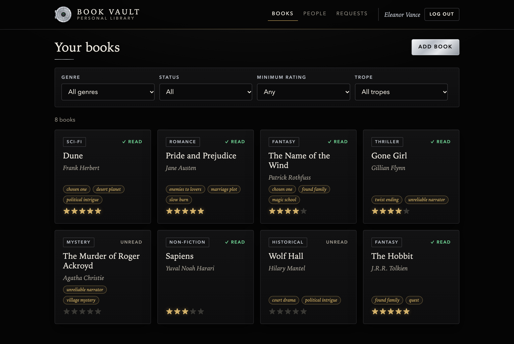

# Book Vault — personal library & reading tracker

Track the books you own: genre, whether you've read them, a 1–5 star rating, a review,
and free-form **tropes** (e.g. *enemies to lovers*, *found family*). Filter by genre,
read status, minimum rating and trope.

Every reader has an **account** and a private vault. Find other readers, read their
reviews and **follow** them: public profiles can be followed at once, private ones need
an accepted follow request.

- **EX1 — backend:** a FastAPI + SQLAlchemy + SQLite REST API in [`book-vault/`](book-vault/)
  ([API docs and examples](book-vault/README.md)).
- **EX2 — frontend:** a React + TypeScript single-page app in [`frontend/`](frontend/),
  integrated with the API, with full loading/empty/error states, component tests, an
  end-to-end flow against the real backend, and a one-command Docker Compose stack.

Evidence that it all works: [docs/proof/social/PROOF-SOCIAL.md](docs/proof/social/PROOF-SOCIAL.md)
for the current version with accounts and social features. Earlier, as submitted:
EX2 [docs/proof/ex2/PROOF-EX2.md](docs/proof/ex2/PROOF-EX2.md), EX1
[book-vault/docs/proof/PROOF.md](book-vault/docs/proof/PROOF.md).



## Architecture

```
                 Docker Compose (docker compose up --build)
 ┌─────────┐    ┌──────────────────────────────┐    ┌───────────────────────┐    ┌──────────────┐
 │ Browser │───▶│ frontend  (nginx :80)        │───▶│ backend (uvicorn :8000)│───▶│ SQLite file  │
 │         │◀───│  /        React SPA (static) │◀───│  FastAPI + SQLAlchemy  │◀───│ /app/data/   │
 └─────────┘    │  /api/*   reverse proxy ─────┼────│  Pydantic validation   │    │ books.db     │
  localhost:8080│  (prefix stripped)           │    │  /auth /users /books   │    │ (named volume│
                └──────────────────────────────┘    └───────────────────────┘    │  book-vault- │
                                                                                 │  data)       │
                                                                                 └──────────────┘
 Local dev: Vite dev server :5173 ── /api proxied (same as nginx) ──▶ uvicorn :8000 ──▶ ./data/books.db
```

- The React app talks to the API through **one typed client**
  ([`frontend/src/api/books.ts`](frontend/src/api/books.ts)) at `VITE_API_URL`
  (default `/api`: the browser always calls its own origin).
- **In Docker**, nginx serves the built app and proxies `/api/*` to the backend
  container. **In local dev**, the Vite dev server does the same (`vite.config.ts`).
  One origin everywhere means no CORS, the login cookie just works, the backend port
  isn't published, and the same image works on any host. Swagger:
  <http://localhost:8080/api/docs> (Docker) or <http://localhost:8000/docs> (dev).
- **Login** uses a random session token in an httpOnly, SameSite=Lax cookie (JavaScript
  can't read it). The database stores only its SHA-256 hash, so logging out really ends
  the session. Passwords are hashed with Argon2id.

## Prerequisites

| Tool | Version used | Needed for |
|------|--------------|------------|
| [Docker](https://docs.docker.com/get-docker/) with Compose v2+ | Docker 29.9, Compose 5.6 | option (a) |
| [uv](https://docs.astral.sh/uv/) | 0.13 (installs Python 3.11 itself) | backend, tests |
| [Node.js](https://nodejs.org/) + npm | Node 22 LTS (≥ 20.19), npm 10 | frontend, tests |

Main libraries: FastAPI 0.162, SQLAlchemy 2.1, Pydantic 2.14 · React 18.3, React Router 7,
Vite 8, TypeScript 6.0 · pytest 9, Vitest 5, Testing Library, Playwright 1.65.

## Get the code

```bash
git clone https://github.com/galamshalem/project.git
cd project
```

## (a) Run everything with Docker Compose

From the repository root:

```bash
docker compose up --build
```

Open <http://localhost:8080> and create an account. The frontend starts once the
backend's `/health` check passes. Data lives in the named volume
`book-vault_book-vault-data`. (Upgrading an older volume is automatic: new tables and
columns are added on start, and the first account created takes over books that
existed before accounts.)

```bash
docker compose up --build -d --wait     # same, in the background, returns when healthy
docker compose ps                       # both services should be "(healthy)"
docker compose logs -f backend          # follow the API logs
docker compose down                     # stop and remove containers (data is kept)
docker compose down -v                  # ...and delete the data volume
FRONTEND_PORT=3000 docker compose up -d # use another host port
```

## (b) Local development

Two terminals. **Backend** (API on <http://localhost:8000>, docs at `/docs`):

```bash
cd book-vault
uv sync
uv run uvicorn app.main:app --reload
```

**Frontend** (app on <http://localhost:5173>, which forwards `/api` to `:8000`):

```bash
cd frontend
npm ci
npm run dev
```

Configuration (all optional):

| Variable | Where | Default | Purpose |
|----------|-------|---------|---------|
| `DATABASE_URL` | backend | `sqlite:///./data/books.db` | SQLite location |
| `SESSION_DAYS` | backend | `30` | How long a login lasts |
| `COOKIE_SECURE` | backend | `false` | Set `true` when served over HTTPS (cookie only sent over HTTPS) |
| `CORS_ORIGINS` | backend | `http://localhost:5173` | Origins allowed to call the API directly (only needed if `VITE_API_URL` points at another origin) |
| `VITE_API_URL` | frontend (dev/build time) | `/api` | API base URL. See `frontend/.env.example` |
| `API_PROXY_TARGET` | frontend (dev server) | `http://localhost:8000` | Where Vite forwards `/api` |

## (c) Run all tests

**Backend** — pytest (146 tests, 100% coverage) and ruff:

```bash
cd book-vault
uv run pytest -v
uv run pytest --cov=app --cov-report=term-missing   # with coverage
uv run ruff check .
uv run ruff format --check .
```

**Frontend** — lint (ESLint + Prettier), typecheck, Vitest + React Testing Library (122 tests):

```bash
cd frontend
npm ci
npm run lint
npm run typecheck
npm test
```

**End-to-end** — Playwright drives Chromium against the **real** backend: the book flow
(sign up, add, filter, edit, invalid input, delete), privacy between two accounts, and
a three-reader social flow (search, follow request, accept, read reviews, public follow).
One command starts uvicorn on `:8001` with a fresh temporary SQLite file and Vite on
`:5174` (so it never touches your dev servers or data), runs the tests, and stops both:

```bash
cd frontend
npx playwright install chromium   # once
npm run test:e2e
npm run test:e2e:report            # open the HTML report (per-step screenshots)
```

On failure, Playwright keeps a screenshot, a video and a trace in `frontend/test-results/`
(`npx playwright show-trace <path>/trace.zip`).

## Features

| | |
|---|---|
| **Book list** | Cards with title, author, genre, read status, star rating and trope chips; responsive down to phone width |
| **Filters** | Genre, read/unread, minimum rating and trope — combined, and kept in the URL so they survive a refresh |
| **Add / edit** | One form for both; tropes as tags with suggestions; quick "mark as read" and star rating on the detail page |
| **Delete** | Confirmed in an in-app dialog |
| **Loading & errors** | Spinners and disabled buttons while saving; empty vault vs. "no matches" states; inline validation that mirrors the API; server `422`s shown next to each field; "Book not found" page; "Can't reach the server" banner with Retry; success toasts; error boundaries |
| **Accounts** | Sign up, log in, log out; every page needs a login and returns you where you were heading; each reader's books are private to them by default |
| **People & profiles** | Search readers by name; profiles show bio, counts and (when allowed) their books as review cards; followers / following lists |
| **Following** | Public profile → follow instantly. Private → "Request to follow", which they accept or decline from **Requests** (badge in the header). Unfollow, cancel a request, or remove a follower at any time |
| **Privacy** | In **Settings** choose Private (default, approve each follower) or Public; name, bio and counts are always visible to logged-in readers, books and reviews only as allowed |

## Repository layout

```
.
├── book-vault/            FastAPI backend: books, auth, social (app/, tests/, Dockerfile) — see its README
├── frontend/              EX2: React + TypeScript SPA
│   ├── src/api/books.ts   typed API client (the only module that calls fetch)
│   ├── src/pages/         list, add, detail/edit, login, register, people, profile, requests, settings
│   ├── src/auth/          session state, route guards
│   ├── src/components/    form, filters, cards, stars, tropes, dialog, banners, toasts, error boundary
│   ├── src/lib/           filters <-> URL, validation, error mapping, formatting
│   ├── e2e/               Playwright: book flow, account privacy, social flow
│   ├── scripts/           capture-proof.mjs (regenerates the proof screenshots)
│   ├── Dockerfile         Node build stage -> nginx runtime stage
│   └── nginx.conf         SPA fallback + /api reverse proxy
├── docker-compose.yml     backend + frontend + named volume
└── docs/proof/            evidence: social/ (current), ex2/ (as submitted for EX2)
```
