# EX2 verification evidence — Book Vault frontend + backend

> **EX2:** *Frontend plus backend — browser UI integrated with EX1: core flows, error states,
> one automated UI or integration flow, and reproducible run instructions.*

Everything here was produced on **2026-11-24** on macOS from this repository (code at commit
`8150903` plus the Phase 6 changes committed with this file).

- **Text files** hold the exact commands and their full, unedited output, ending in
  `[exit code: N]`. Every exit code is 0.
- **Screenshots 01–15** were taken by [`frontend/scripts/capture-proof.mjs`](../../../frontend/scripts/capture-proof.mjs)
  (Playwright + Chromium, 1280×860, 2× pixel density). They show the **Docker Compose stack**
  at `http://localhost:8080`, talking to the real backend. Run `node scripts/capture-proof.mjs`
  in `frontend/` to regenerate them.
- **Screenshots 16–17** are of Playwright's own HTML report for the run in `04-playwright-e2e.txt`.

## Summary

| Requirement | Evidence | Result |
|---|---|---|
| **Core flows** — list, filter, add, view/edit, quick actions, delete | Screenshots 02–06, 09–11; Vitest flow tests; e2e steps 1–7 | ✅ |
| **Error states** — loading, empty, validation, 422, 404, backend down, success feedback, crash fallback | Screenshots 01, 05, 07, 08, 12–14; [03-vitest.txt](03-vitest.txt) | ✅ |
| **Automated flow** — Playwright against the real backend on a fresh SQLite file | [04-playwright-e2e.txt](04-playwright-e2e.txt), screenshots 16–17 | ✅ 1 passed, 7/7 steps |
| **Reproducible run** — one-command Docker stack, local dev, tests | [README](../../../README.md), [05-docker.txt](05-docker.txt), screenshot 15 | ✅ |
| **EX1 not broken** — backend tests and lint | [01-backend-checks.txt](01-backend-checks.txt) | ✅ 79 passed, 100% coverage, ruff clean |
| **Frontend quality gates** — lint, typecheck, build, unit/component tests | [02-frontend-checks.txt](02-frontend-checks.txt), [03-vitest.txt](03-vitest.txt) | ✅ 91 passed |

## Evidence files

| # | File | What it shows |
|---|------|---------------|
| 01 | [01-backend-checks.txt](01-backend-checks.txt) | `ruff check`, `ruff format --check`, `pytest -v --cov`: 79 passed, 100% coverage |
| 02 | [02-frontend-checks.txt](02-frontend-checks.txt) | `npm run lint` (ESLint + Prettier), `npm run typecheck`, `npm run build` |
| 03 | [03-vitest.txt](03-vitest.txt) | Vitest + React Testing Library, verbose: 91 tests in 10 files |
| 04 | [04-playwright-e2e.txt](04-playwright-e2e.txt) | `npm run test:e2e`: both servers start automatically, all 7 steps pass |
| 05 | [05-docker.txt](05-docker.txt) | `docker compose up --build`, health, nginx routes, backend outage (502), persistence across `down`/`up` |

## 1. Core flows

**Book list.** Cards show the title, author, genre, read status, rating as stars, and trope
chips. At phone width the filters stack two by two and the cards fill the width, with no
horizontal scroll.

| Desktop | Phone (390 px) |
|---|---|
|  | 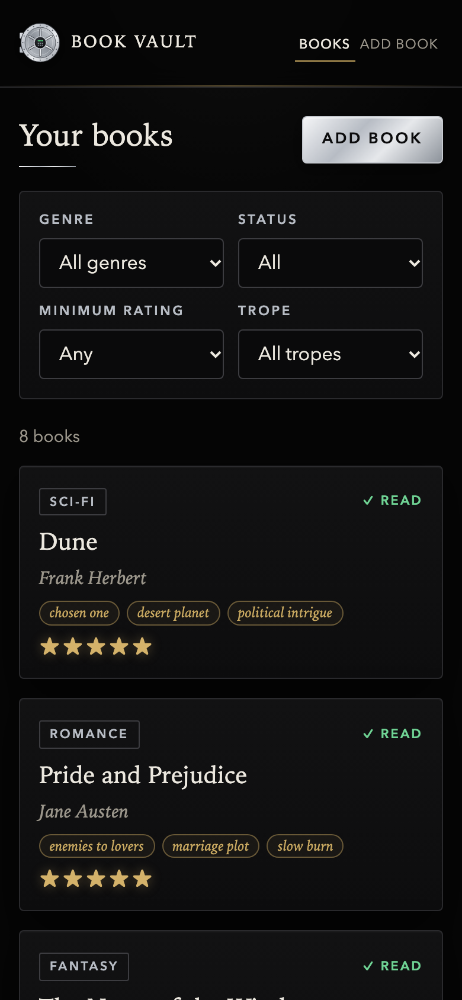 |

**Filters.** Genre, read/unread/all, minimum rating and trope. They combine, and they live in
the URL, so a refresh or a shared link keeps them. Here it's `?trope=found family&status=read`:

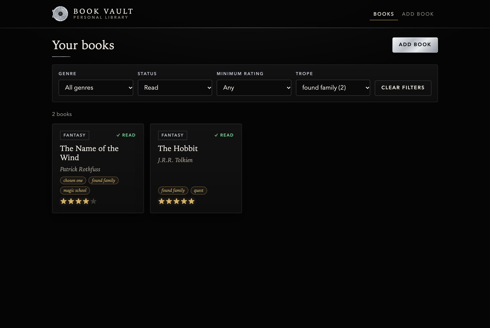

**Add book.** Title, author, genre (from the API's enum), tropes as tags with suggestions,
an optional 1–5 rating, read status and review:

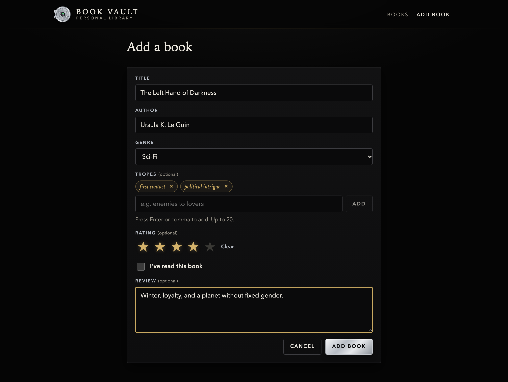

**Book detail and edit.** Quick "mark as read/unread" and quick star rating, each confirmed
by a toast, plus a full edit form for every field:

| Detail, after a quick action | Edit view |
|---|---|
| 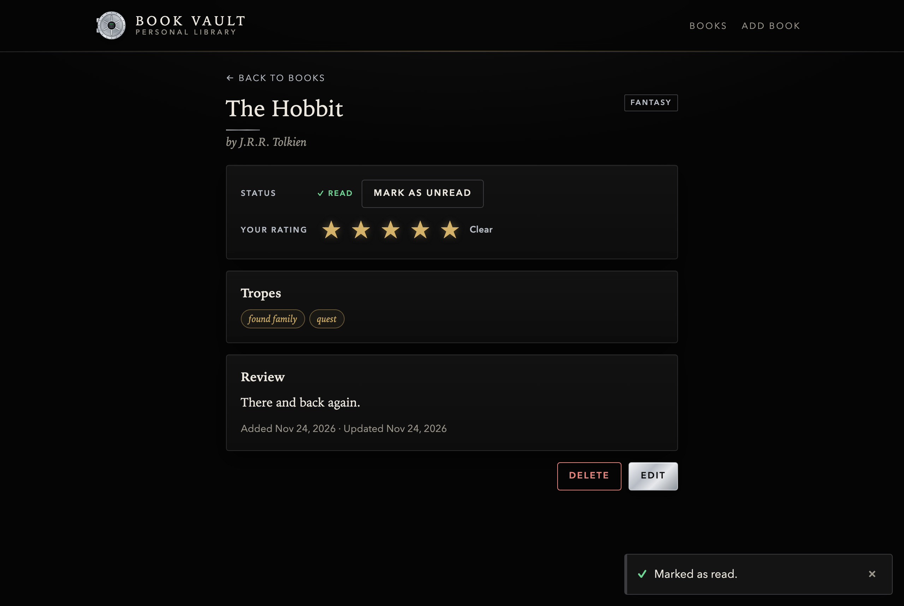 | 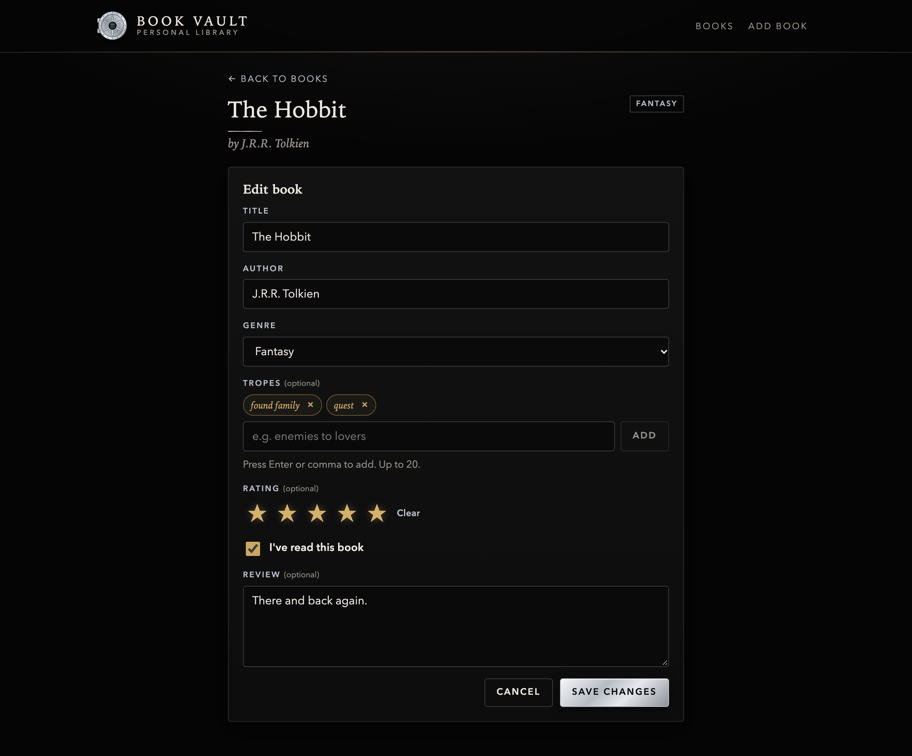 |

**Delete.** Confirmed in an in-app dialog, not `window.confirm`. Focus is trapped inside,
and Escape or Cancel closes it:

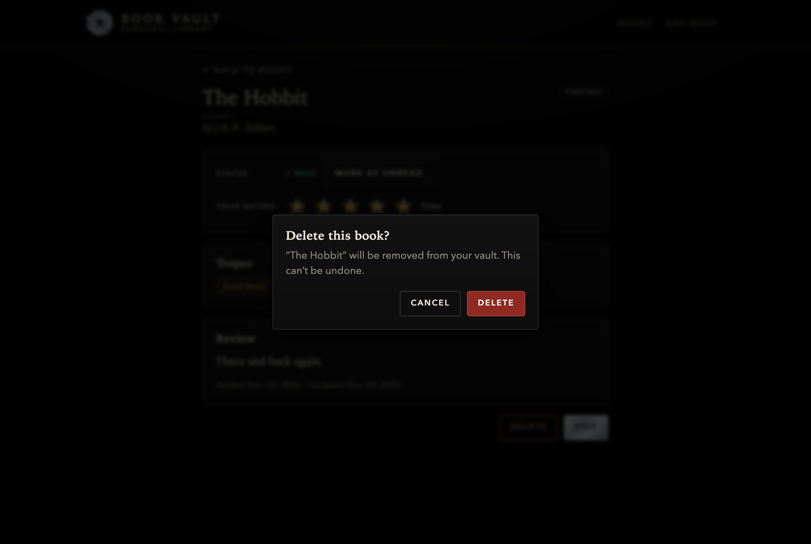

**The list updates without a full reload** after every change. The React Router
navigations refetch the list. The e2e test checks this in steps 2–3 and 7, and so do the
`flows.test.tsx` tests.

## 2. Error and loading states

| State | How it works | Evidence |
|---|---|---|
| **Loading** | Spinner and placeholder cards on the first load; "Updating…" while filters change; every control disabled while saving; a second submit is ignored | `states.test.tsx › loading state`, `states.test.tsx › BookForm while saving` in [03-vitest.txt](03-vitest.txt) |
| **Empty vault** | Its own state with an "Add your first book" button | 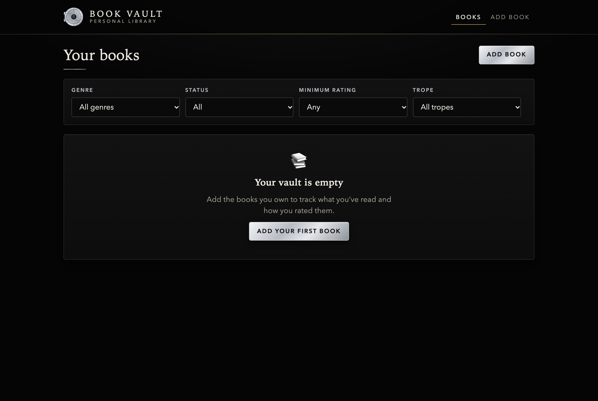 |
| **No filter matches** | A separate state with a Clear filters button | 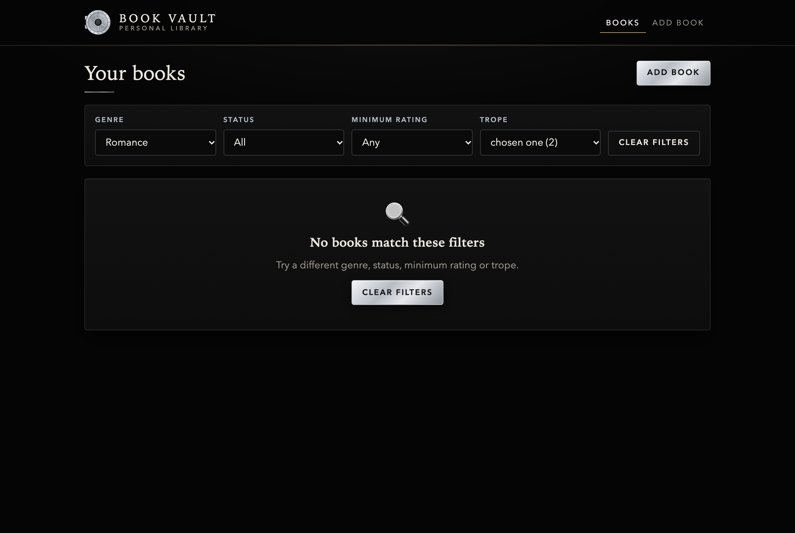 |
| **Client validation** | Mirrors the Pydantic rules: title and author can't be blank after trimming, genre must be in the enum, rating 1–5, up to 20 tropes of ≤ 50 characters. Shown inline when you leave a field or submit; focus moves to the first problem | 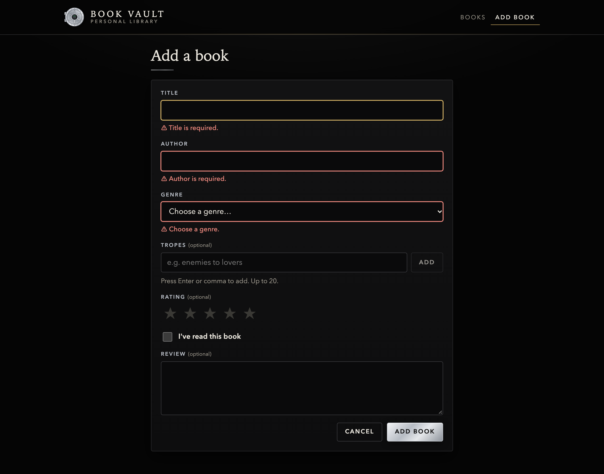 |
| **Server 422** | FastAPI's `detail` array is parsed and each message shown next to its field. For this screenshot the request was altered in flight, so these are the **real** backend's messages | 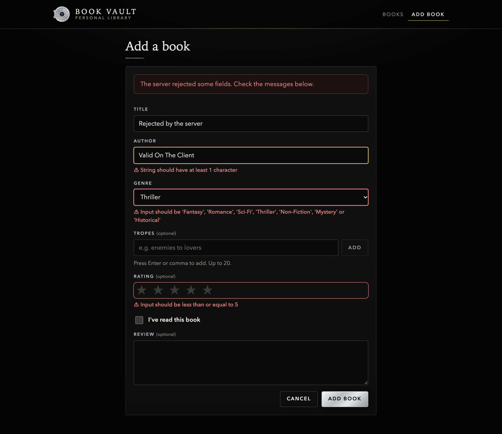 |
| **404** | `/books/9999` shows "Book not found". Ids that aren't numbers and unknown routes are handled too | 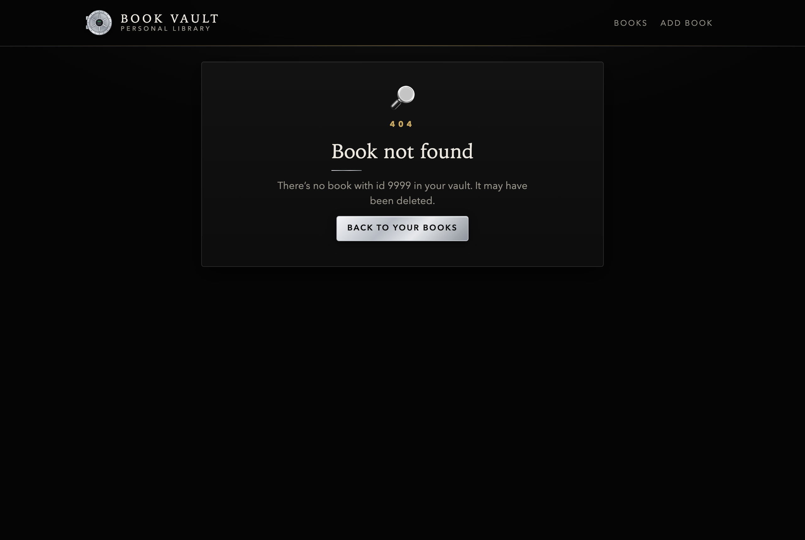 |
| **Backend unreachable** | The backend container was **stopped**. The banner explains the problem and offers Retry; the app doesn't go blank. After `docker compose start backend`, Retry brings the list back | 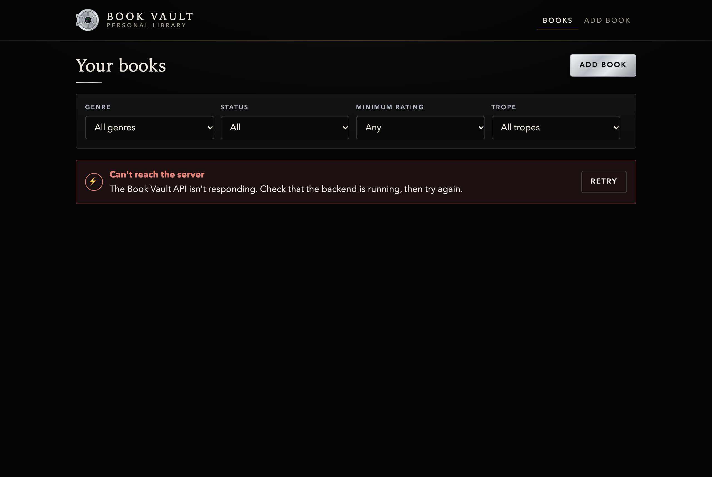 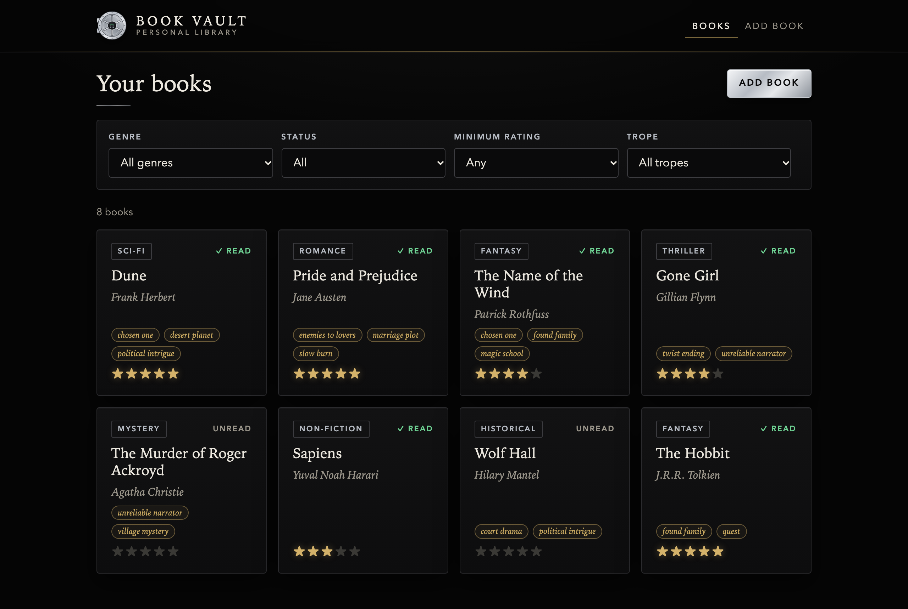 |
| **Success feedback** | Toasts for create, update, quick actions and delete; screen readers announce them | Screenshot 09; e2e steps 2, 5, 7 |
| **Crash fallback** | Error boundaries around each page and at the root show a "Something went wrong" page instead of a white screen | `states.test.tsx › ErrorBoundary` in [03-vitest.txt](03-vitest.txt) |

The component tests the brief asks for, with the API client mocked, are all in
[03-vitest.txt](03-vitest.txt):

- **Form validation:** `BookForm.test.tsx › client-side validation`
- **422 errors from the server:** `BookForm.test.tsx › server 422 errors`
- **Empty state:** `states.test.tsx › empty states`
- **Network-error banner:** `states.test.tsx › network-error banner`

## 3. Automated integration flow

[`frontend/e2e/book-flow.spec.ts`](../../../frontend/e2e/book-flow.spec.ts) runs in Chromium
against the **real** FastAPI backend. `playwright.config.ts` starts uvicorn on `:8001`,
pointed at a SQLite file it deletes first, and Vite on `:5174`, then shuts both down. One
command does it all: `npm run test:e2e`. On failure, Playwright keeps a trace, a screenshot
and a video.

| Step | What it checks |
|---|---|
| 1. open the app | A book seeded through the API is shown, so the data comes from the backend |
| 2. add a book | The UI form, tropes included; the backend returns `201`; success toast |
| 3. see it in the list | Author, genre, "Unread", "Not rated", the tropes, "2 books" |
| 4. filter by its genre | The other book disappears; `?genre=Fantasy` survives a reload; filtering by trope works too |
| 5. open it, mark as read, give 5 stars | Toasts, and a check through the API that the server saved both |
| 6. invalid action | Saving a title of only spaces shows "Title is required." with focus on the field; the API shows nothing changed |
| 7. delete it, confirm it's gone | Dialog, toast, the filtered list is now empty, the API returns `404`, and its page shows "Book not found" |

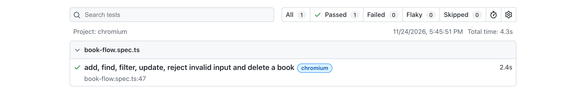

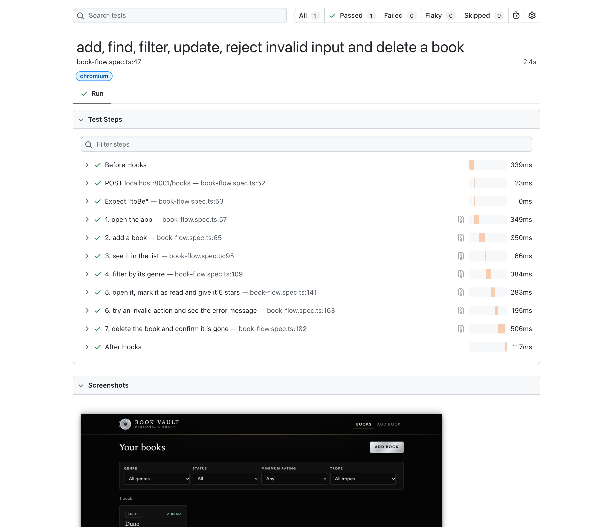

## 4. Reproducible run

- **One command:** `docker compose up --build` from the repo root. The backend has a named
  SQLite volume and a `/health` healthcheck, and the frontend starts only once the backend
  is healthy. [05-docker.txt](05-docker.txt) shows the build, both services `(healthy)`,
  the SPA fallback for client routes (`/books/12` gets `index.html`), and `/api/*` proxied
  to the backend. Stopping the backend gives a JSON `502`. The same 8 books come back after
  `docker compose down` and `up`.
- **API calls in Docker:** nginx proxies `/api` to the backend, and the frontend is built
  with `VITE_API_URL=/api`. One origin means no CORS; the backend port isn't published; one
  image works on any host. The [README](../../../README.md#architecture) explains the choice.
  Swagger also works through the proxy:

  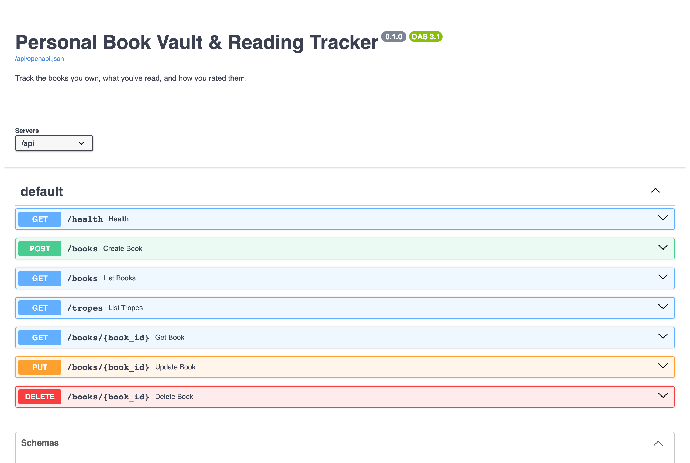

- **Local dev and tests:** the [README](../../../README.md) gives copy-paste commands for
  uv and npm and for every test suite. Those commands were run from a clean copy of the
  repository (tracked files only: no `node_modules`, `.venv` or data). Results: 79 pytest,
  ruff clean, `npm ci`, lint and typecheck clean, 91 Vitest, e2e passed.

## Bugs found while testing (fixed, with regression tests)

1. **Lost Save click.** Pressing Save blurred the field first; the inline error that
   appeared pushed the button down, so the click missed. Form buttons now keep focus in
   the field until the click fires (`BookForm.test.tsx › regression…`).
2. **Server errors wiped on blur.** Moving focus after a 422 re-ran client validation and
   erased the server's message. Client and server errors are now stored separately.
3. **Toast covering buttons.** A success toast sat on top of the Edit button for 4 seconds.
   The e2e step timings showed it (step 6 took 4.1s). Toasts now let clicks pass through
   to what's underneath, except on their × button.
